# Netflix content recommender

This is a small, reproducible online recommender built for the supplied ML engineering assignment. It validates and
prepares the 32k-item catalogue, trains a hybrid recommender, gates a portable model bundle, and serves per-user results
from FastAPI.

> **Simulated-data notice:** the supplied catalogue contains no users, events, or per-user ratings. This project clearly
> simulates interactions behind an `InteractionSource` interface. Offline metrics measure recovery of the simulator's
> own rules and are regression gates, **not evidence of real-world recommendation quality**.

## Quickstart

Python 3.12 is required. The main path does not require Docker, Make, Conda, or `uv`.

Windows PowerShell:

```powershell
py -3.12 -m venv "$env:LOCALAPPDATA\venvs\netflix-reco"
& "$env:LOCALAPPDATA\venvs\netflix-reco\Scripts\Activate.ps1"
python -m pip install -e ".[dev]"
$env:RECO_HOME = "$env:LOCALAPPDATA\netflix-reco"
$env:OPENBLAS_NUM_THREADS = "1"
$env:OMP_NUM_THREADS = "1"
python -m reco run-all
python -m reco serve
```

macOS/Linux:

```bash
python3.12 -m venv /tmp/netflix-reco-venv
. /tmp/netflix-reco-venv/bin/activate
python -m pip install -e '.[dev]'
export RECO_HOME="${RECO_HOME:-$PWD/var}"
export OPENBLAS_NUM_THREADS=1 OMP_NUM_THREADS=1
python -m reco run-all
python -m reco serve
```

`run-all` downloads the two files at the pinned Git commit, verifies SHA-256, and runs `ingest -> validate -> prepare ->
simulate -> train -> evaluate -> promote`. Runtime data, bundles, and `mlflow.db` live under `RECO_HOME` (default
`./var`, which is gitignored). To avoid a download, pass a directory containing the two original CSVs:

```bash
python -m reco run-all --source /path/to/DSAssignmentDataSet
```

Every stage is independently runnable:

```bash
python -m reco ingest
python -m reco validate
python -m reco prepare
python -m reco simulate
python -m reco train
python -m reco evaluate
python -m reco promote
python -m reco promote --version 20261102-abc1234  # still checks the quality gate
python -m reco promote --version 20261102-abc1234 --force  # explicit trusted rollback only
```

## Docker quickstart

Docker Compose runs training first, saves its model artifacts in a persistent named volume, and then starts the API:

```bash
docker compose up --build
curl -fsS http://localhost:8000/readyz
curl -fsS -X POST http://localhost:8000/v1/recommendations \
  -H 'Content-Type: application/json' \
  -d '{"user_id":"A","limit":3}'
```

The trainer downloads the pinned source CSV files on the first run, so outbound access to GitHub is required. The
container sets `RECO_PROJECT_ROOT=/app` to find its config files after a non-editable pip install. A source commit can
optionally be supplied with `RECO_GIT_SHA`; without Git metadata, the manifest records `unknown`. Use
`docker compose down` to stop the services; `docker compose down -v` also deletes the trained artifacts.

CI trains on the committed 300-item fixture in containers and verifies the API over HTTP.
The full-data acceptance check uses a separate fresh run to avoid relying on saved local artifacts.
The demonstration endpoint is **unauthenticated** and must not be exposed to the public internet; put a
gateway with authentication, authorization, and user-to-token identity binding in front of any real deployment.
Docker Compose binds API and optional MLflow ports to localhost only.

## How does it work

```mermaid
flowchart LR
    A["Pinned catalogue CSVs"] --> B["Pandera quality gate"]
    B --> C["Namespacing, genre map, policy"]
    C --> D["Canonical catalogue"]
    D --> E["InteractionSource"]
    E -->|"default"| F["Deterministic simulator"]
    E -->|"config swap"| G["Parquet real events"]
    F --> H["Temporal split"]
    G --> H
    H --> I["Item-kNN"]
    H --> J["TF-IDF + SVD content"]
    H --> K["Popularity"]
    I --> L["0.6 / 0.3 / 0.1 hybrid"]
    J --> L
    K --> L
    L --> M["Recall/NDCG promotion gate"]
    M --> N["JSON + NPZ + NPY bundle"]
    N --> O["Atomic CHAMPION pointer"]
    O --> P["FastAPI in-memory scorer"]
    P --> Q["Policy, watched, type, duplicate, diversity"]
```



The primary signal is item-kNN over watch-weighted behavior. A compact TF-IDF/SVD model reaches items with no training
events; it is included for catalogue reach, not because it wins offline accuracy. Popularity handles unknown users and
degraded requests. The serving weights and diversity fraction are saved in the model manifest. Offline hybrid evaluation
uses the same model selection, exclusion, deduplication, and diversity rules as the API; the gate should be assessed on
the **served list**, not just an unrestricted score list. The API holds an immutable in-memory snapshot; pointer
checks are throttled, and new bundles load outside the state lock so existing requests continue using the previous
version. A failed reload keeps the last known-good snapshot.

The API process never imports pandas, scikit-learn, or MLflow and never loads pickle. The MLflow registry wrapper may use
CloudPickle internally, but serving reads only JSON, NPZ, and NPY.

## How to feed input and get output

With `python -m reco serve` running on port 8000:

```bash
curl -sS -X POST http://127.0.0.1:8000/v1/recommendations \
  -H 'Content-Type: application/json' \
  -d '{"user_id":"A","limit":3}'
```

Captured from the **full-data CI run on 2026-11-04** (commit `57a481a`, [workflow run #41793452268](https://github.com/KittituchW/MLE_assignment/actions/runs/41793452268)).
Request IDs and source commit suffixes change between executions.

```json
{
  "request_id": "c4898f5001bb4b00a2bd6ec0c47ddf5a",
  "user_id": "A",
  "strategy": "personalized",
  "model_version": "20261102-57a481a",
  "items": [
    {
      "rank": 1,
      "item_id": "movie_759507",
      "title": "Blackout",
      "content_type": "movie",
      "genres": ["Action", "Adventure", "Thriller"],
      "release_year": 2022,
      "score": 0.592786,
      "reason": "Based on your viewing preferences"
    },
    {
      "rank": 2,
      "item_id": "movie_571446",
      "title": "Mojin: The Worm Valley",
      "content_type": "movie",
      "genres": ["Action", "Adventure", "Fantasy"],
      "release_year": 2018,
      "score": 0.57003,
      "reason": "Based on your viewing preferences"
    },
    {
      "rank": 3,
      "item_id": "movie_299536",
      "title": "Avengers: Infinity War",
      "content_type": "movie",
      "genres": ["Action", "Adventure", "Science Fiction"],
      "release_year": 2018,
      "score": 0.551159,
      "reason": "Based on your viewing preferences"
    }
  ]
}
```

Optional request fields are `limit` (1-50, default 10) and `content_type` (`movie` or `tv`). Unknown users receive HTTP
200 with `cold_start_popular`; invalid input receives 422. Other endpoints are:

| Endpoint | Purpose |
|---|---|
| `GET /healthz` | Process liveness |
| `GET /readyz` | 200 only when a valid bundle is loaded |
| `GET /metrics` | Prometheus request, latency, strategy, and model metrics |
| `GET /v1/model` | Active bundle manifest and provenance |

One structured JSON exposure line is logged per successful request with request ID, user ID, model version, strategy,
and returned item IDs. User IDs and exposure logs should be pseudonymized and access-controlled in a real service.
The demo response uses generic preference explanations rather than disclosing watched titles.

## Evaluation and verification

**Measured full-data results** from [GitHub Actions run #41793452268](https://github.com/KittituchW/MLE_assignment/actions/runs/41793452268)
on 2026-11-04. The pipeline used the pinned full 2025 catalogue, seed 42, 1,500 test users, and a final 14-day
temporal holdout. **These metrics evaluate deterministic simulated interactions, not real-world user quality.**
The hybrid row uses the same short-history fallback, filtering, deduplication, and diversity rules as serving.

| Model | Recall@10 | NDCG@10 | Catalogue coverage | Cold-item share |
|---|---:|---:|---:|---:|
| Popularity | 0.0196 | 0.0125 | 0.07% | 0.00% |
| Item-kNN | 0.0440 | 0.0342 | 6.25% | 0.00% |
| Content | 0.0057 | 0.0027 | 7.39% | 61.14% |
| **Hybrid** | **0.0479** | **0.0354** | **6.12%** | **0.37%** |

The test window included 15,816 new-to-user events. The model passed its promotion gate **without** a forced
override. The same run passed 35 tests (one full-data-dependent test skipped in the initial test stage), reached
84.22% coverage, then ran the full-data acceptance test and a Dockerized fixture/API smoke test successfully.

CI also prints a fresh evaluation table and real API example via `python scripts/report_evaluation.py` after each
full-data acceptance run, avoiding stale hardcoded results. The checked-in results above are from the explicitly
linked execution; future changes can legitimately produce different metrics.

## Tests and operational checks

```bash
ruff check .
ruff format --check .
mypy src/reco
pytest --cov=reco --cov-report=term-missing
pytest -m slow                         # full-data acceptance after run-all
python scripts/smoke.py               # starts a real uvicorn subprocess
python scripts/loadtest.py            # reports HTTP p50/p95/p99
```

The committed test catalogue contains 300 real rows (150 per content type), including the real `show_id=18823`
cross-file collision. Raw full data, runtime artifacts, databases, and virtual environments are not committed.

## Submission packaging

The assignment asks for a **whole Git repository**, not just a source-code snapshot. From a machine with Git,
Python, and access to GitHub, run:

```bash
python scripts/package_submission.py
```

This clones the current `main` branch into a clean temporary directory, creates `MLE_assignment_submission.zip`,
and verifies ZIP integrity and the included `MLE_assignment/.git/HEAD`. It preserves actual commit authors and
history rather than rewriting provenance. A GitHub "Download ZIP" does **not** contain `.git`.

## Limitations

- The behavior is simulated; personas and offline metrics encode the simulator's assumptions.
- The catalogue has no maturity/adult field. The layered keyword/evidence/denylist heuristic is not a maturity system and
  output is **not family-safe**. It has known misses and false positives; mainstream mature titles can pass. Production
  needs licensed maturity and territory-rights data.
- Popularity is a catalogue snapshot with a strong recency bias and different movie/TV scales.
- Content embeddings are English-token oriented, and descriptions are missing for many titles.
- The served model uses a pre-test training snapshot, excluding the final test window. A future production pipeline
  should refit an approved configuration on all eligible recent history and retain the evaluation lineage. Real-time
  interaction ingestion is not implemented.
- Single-process scoring is intentional for the assignment. Horizontal production scale is described in
  `docs/architecture.md`.

## How to improve in the future

1. Replace `SimulatedInteractionSource` with consented exposure, play, completion, like, and dismiss events through the
   already-tested `ParquetInteractionSource` seam; add event contracts and late-data handling.
2. Add sequence or two-tower retrieval with approximate nearest-neighbour search after real behavior volume justifies it,
   then train a learning-to-rank layer using position-aware exposure labels.
3. Add licensed maturity, age-rating, territory licensing, and availability feeds before presenting the system as safe or
   rights-aware.
4. Run A/B tests against a stable control with user-level holdouts. Only add contextual bandits for row order after
   trustworthy exposure and reward logs exist.
5. Join real ratings such as MovieLens through TMDb IDs for research only. `show_id` appears to be a TMDb ID, but the join
   is untested and MovieLens licensing must be checked for the intended use.
6. At scale, cache hot users, use a feature store/vector index, and materialize batch top-N as a fallback while retaining
   online re-ranking for policy and context.

See `docs/architecture.md`, `docs/decisions.md`, and `docs/data_notes.md` for the production design and trade-offs.
