# Netflix content recommender

This is a small, reproducible online recommender built for the supplied ML engineering assignment. It validates and
prepares the 32k-item catalogue, trains a hybrid recommender, gates a portable model bundle, and serves per-user results
from FastAPI.

> **Simulated-data notice:** the supplied catalogue contains no users, events, or per-user ratings. This project clearly
> simulates interactions behind an `InteractionSource` interface. Offline metrics measure recovery of the simulator's
> own rules and are regression gates, **not evidence of real-world recommendation quality**.

## Quickstart

Python 3.12 is required. The main path does not require Docker, Make, Conda, or `uv`.

Windows PowerShell (recommended on the assignment machine):

```powershell
py -3.12 -m venv "$env:LOCALAPPDATA\venvs\netflix-reco"
& "$env:LOCALAPPDATA\venvs\netflix-reco\Scripts\Activate.ps1"
python -m pip install --use-feature=truststore -e ".[dev]"
$env:RECO_HOME = "$env:LOCALAPPDATA\netflix-reco"
$env:OPENBLAS_NUM_THREADS = "1"
$env:OMP_NUM_THREADS = "1"
python -m reco run-all
python -m reco serve
```

macOS/Linux:

```bash
python3.12 -m venv /tmp/netflix-reco-venv
. /tmp/netflix-reco-venv/bin/activate
python -m pip install --use-feature=truststore -e '.[dev]'
export RECO_HOME="${RECO_HOME:-$PWD/var}"
export OPENBLAS_NUM_THREADS=1 OMP_NUM_THREADS=1
python -m reco run-all
python -m reco serve
```

`run-all` downloads the two files at the pinned Git commit, verifies SHA-256, and runs `ingest -> validate -> prepare ->
simulate -> train -> evaluate -> promote`. Runtime data, bundles, and `mlflow.db` live under `RECO_HOME` (default
`./var`, which is gitignored). To avoid a download, pass a directory containing the two original CSVs:

```bash
python -m reco run-all --source /path/to/DSAssignmentDataSet
```

Every stage is independently runnable:

```bash
python -m reco ingest
python -m reco validate
python -m reco prepare
python -m reco simulate
python -m reco train
python -m reco evaluate
python -m reco promote
python -m reco promote --version 20261102-abc1234  # explicit rollback
```

## How does it work

```mermaid
flowchart LR
    A["Pinned catalogue CSVs"] --> B["Pandera quality gate"]
    B --> C["Namespacing, genre map, policy"]
    C --> D["Canonical catalogue"]
    D --> E["InteractionSource"]
    E -->|"default"| F["Deterministic simulator"]
    E -->|"config swap"| G["Parquet real events"]
    F --> H["Temporal split"]
    G --> H
    H --> I["Item-kNN"]
    H --> J["TF-IDF + SVD content"]
    H --> K["Popularity"]
    I --> L["0.6 / 0.3 / 0.1 hybrid"]
    J --> L
    K --> L
    L --> M["Recall/NDCG promotion gate"]
    M --> N["JSON + NPZ + NPY bundle"]
    N --> O["Atomic CHAMPION pointer"]
    O --> P["FastAPI in-memory scorer"]
    P --> Q["Policy, watched, type, duplicate, diversity"]
```



The primary signal is item-kNN over watch-weighted behavior. A compact TF-IDF/SVD model reaches items with no training
events; it is included for catalogue reach, not because it wins offline accuracy. Popularity handles unknown users and
degraded requests. The API holds one read-only bundle in memory, fully validates a newly promoted bundle before swapping
the reference, and keeps serving the previous version after a failed reload.

The API process never imports pandas, scikit-learn, or MLflow and never loads pickle. The MLflow registry wrapper may use
CloudPickle internally, but serving reads only JSON, NPZ, and NPY.

## How to feed input and get output

With `python -m reco serve` running on port 8000:

```bash
curl -sS -X POST http://127.0.0.1:8000/v1/recommendations \
  -H 'Content-Type: application/json' \
  -d '{"user_id":"A","limit":3}'
```

Captured from the running uvicorn service on 2026-11-02 (the request ID is different on every call):

```json
{
  "request_id": "824b7beaa1c94e719c052dc565e030bc",
  "user_id": "A",
  "strategy": "personalized",
  "model_version": "20261102-reviewed",
  "items": [
    {
      "rank": 1,
      "item_id": "movie_759507",
      "title": "Blackout",
      "content_type": "movie",
      "genres": ["Action", "Adventure", "Thriller"],
      "release_year": 2022,
      "score": 0.592537,
      "reason": "Because you watched Golden Kamuy"
    },
    {
      "rank": 2,
      "item_id": "movie_571446",
      "title": "Mojin: The Worm Valley",
      "content_type": "movie",
      "genres": ["Action", "Adventure", "Fantasy"],
      "release_year": 2018,
      "score": 0.569779,
      "reason": "Because you watched Golden Kamuy"
    },
    {
      "rank": 3,
      "item_id": "movie_299536",
      "title": "Avengers: Infinity War",
      "content_type": "movie",
      "genres": ["Action", "Adventure", "Science Fiction"],
      "release_year": 2018,
      "score": 0.551833,
      "reason": "Because you watched Golden Kamuy"
    }
  ]
}
```

Optional request fields are `limit` (1-50, default 10) and `content_type` (`movie` or `tv`). Unknown users receive HTTP
200 with `cold_start_popular`; invalid input receives 422. Other endpoints are:

| Endpoint | Purpose |
|---|---|
| `GET /healthz` | Process liveness |
| `GET /readyz` | 200 only when a valid bundle is loaded |
| `GET /metrics` | Prometheus request, latency, strategy, and model metrics |
| `GET /v1/model` | Active bundle manifest and provenance |

One structured JSON exposure line is logged per successful request with request ID, user ID, model version, strategy,
and returned item IDs.

## Measured results

Full 2026-11-02 run, seed 42, 1,500 test users, final 14-day temporal holdout:

| Model | Recall@10 | NDCG@10 | Coverage | Cold-item share |
|---|---:|---:|---:|---:|
| Popularity | 0.0193 | 0.0120 | 0.07% | 0.00% |
| Item-kNN | 0.0448 | 0.0345 | 6.20% | 0.00% |
| Content | 0.0030 | 0.0018 | 7.14% | 62.17% |
| **Hybrid** | **0.0499** | **0.0362** | **5.62%** | **0.02%** |

The gate passed. Simulator output had 5,000 users, 205k events, median 29 events/user, and 17.1% of events on the top 1%
of items. The prepared catalogue had 31,991 unique items and 29,443 recommendable items after the reviewed policy.

Tests: 28 passed with 83% coverage. Real HTTP sequential load check (300 requests): p50 5.121 ms, p95 5.799 ms, p99
6.126 ms on this machine. Docker files were reviewed but **not executed**; container execution was outside this
environment's verified path.

## Tests and operational checks

```bash
ruff check .
ruff format --check .
mypy src/reco
pytest --cov=reco --cov-report=term-missing
pytest -m slow                         # full-data acceptance after run-all
python scripts/smoke.py               # starts a real uvicorn subprocess
python scripts/loadtest.py            # reports HTTP p50/p95/p99
```

The committed test catalogue contains 300 real rows (150 per content type), including the real `show_id=18823`
cross-file collision. Raw full data, runtime artifacts, databases, and virtual environments are not committed.

## Limitations

- The behavior is simulated; personas and offline metrics encode the simulator's assumptions.
- The catalogue has no maturity/adult field. The layered keyword/evidence/denylist heuristic is not a maturity system and
  output is **not family-safe**. It has known misses and false positives; mainstream mature titles can pass. Production
  needs licensed maturity and territory-rights data.
- Popularity is a catalogue snapshot with a strong recency bias and different movie/TV scales.
- Content embeddings are English-token oriented, and descriptions are missing for many titles.
- Single-process scoring is intentional for the assignment. Horizontal production scale is described in
  `docs/architecture.md`.

## How to improve in the future

1. Replace `SimulatedInteractionSource` with consented exposure, play, completion, like, and dismiss events through the
   already-tested `ParquetInteractionSource` seam; add event contracts and late-data handling.
2. Add sequence or two-tower retrieval with approximate nearest-neighbour search after real behavior volume justifies it,
   then train a learning-to-rank layer using position-aware exposure labels.
3. Add licensed maturity, age-rating, territory licensing, and availability feeds before presenting the system as safe or
   rights-aware.
4. Run A/B tests against a stable control with user-level holdouts. Only add contextual bandits for row order after
   trustworthy exposure and reward logs exist.
5. Join real ratings such as MovieLens through TMDb IDs for research only. `show_id` appears to be a TMDb ID, but the join
   is untested and MovieLens licensing must be checked for the intended use.
6. At scale, cache hot users, use a feature store/vector index, and materialize batch top-N as a fallback while retaining
   online re-ranking for policy and context.

See `docs/architecture.md`, `docs/decisions.md`, and `docs/data_notes.md` for the production design and trade-offs.
