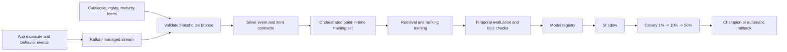
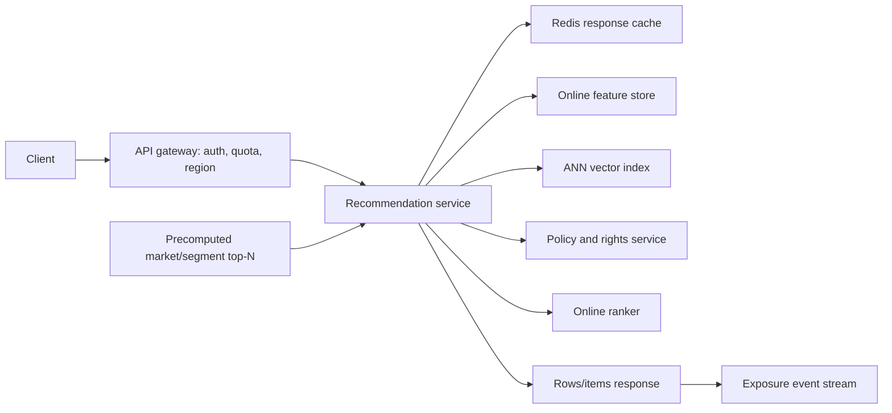
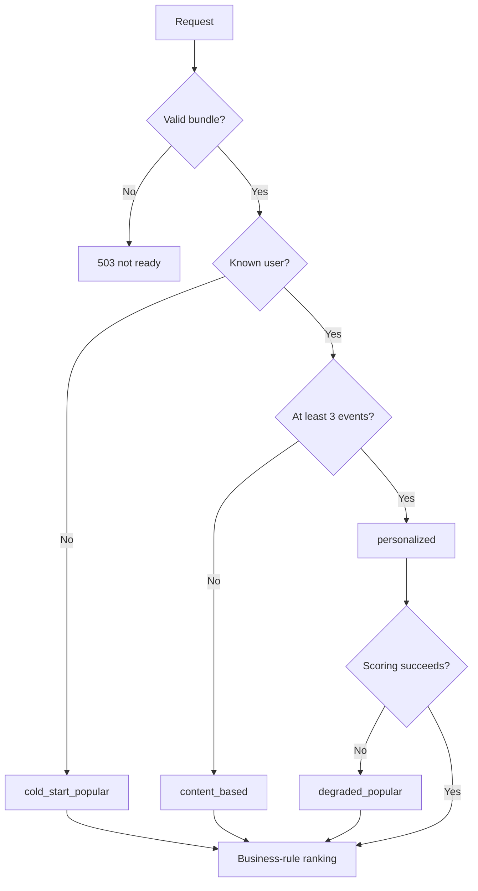

# Production architecture

The repository implements the smallest online system that satisfies the assignment. The production design keeps its
interfaces while replacing single-machine storage and simulated events with managed, observable components.

## Built here versus production

| Concern | Built here | Production path |
|---|---|---|
| Behavior | Deterministic simulator or Parquet | Versioned event contracts from an exposure/play stream |
| Catalogue | Checksummed CSV, local Parquet | CDC/API ingestion into a governed lakehouse |
| Orchestration | Ordered `python -m reco` stages | Airflow/Dagster/Argo with retries, lineage, and backfills |
| Training | One Python process | Isolated CPU jobs, distributed only when data requires it |
| Registry | Local MLflow SQLite + alias | Managed registry, signed artifacts, approval policy |
| Retrieval | In-memory sparse kNN and SVD | Two-tower/sequence retrieval plus ANN index |
| User features | Bundle history CSR | Low-latency feature store with event-time semantics |
| Serving | One FastAPI worker | Autoscaled stateless pods, cache, canary rollout |
| Fallback | In-memory popular scores | Cached/precomputed top-N by market and segment |

## Offline path

Every dataset and bundle is immutable and content-addressed. The gate checks ranking quality, coverage, policy regressions,
fairness slices, latency, and schema compatibility. Promotion changes an alias/pointer, never overwrites an artifact.

## Online path

The gateway routes users to a stable experiment arm. The service reads recent history with event-time/version metadata,
retrieves candidates from ANN and cached popular pools, applies availability and safety policy, ranks, and logs exactly
what was exposed. Precomputed top-N is a scale/degradation path, not the primary implementation in this repository.

## Fallbacks and failure modes

- A corrupt hot-swap target is rejected and cached as failed for the current pointer value; the old in-memory model
  continues serving. Model and version are read as a matching snapshot.
- Feature-store timeout uses a bounded stale value, then market popular; the response records degradation.
- ANN failure uses cached/precomputed candidates. Policy/rights failure is fail-closed for restricted content.
- Registry/lakehouse outages stop promotion but do not affect the current serving bundle.
- Event-stream lag affects learning freshness, not synchronous serving; alert on lag and missing exposure volume.

## SLO and capacity

Proposed availability SLO: 99.9% monthly for recommendations, with `/healthz` excluded and valid 4xx requests counted as
available. Latency SLO: p95 <100 ms and p99 <200 ms at the gateway. Freshness: 99% of accepted behavior appears in online
features within 60 seconds; champion age under seven days unless promotion is intentionally frozen.

The earlier local sequential HTTP test reported p95 5.799 ms under a single-client workload. That figure is **not**
a concurrency or throughput benchmark and should not be used to size production replicas. Before capacity planning,
run concurrent traffic tests with realistic history lengths and the full catalogue, including simultaneous hot swaps.

## Monitoring

- **Service:** request rate/errors/duration, readiness, saturation, queue time, strategy mix, cache hit rate, hot-swap
  success, active model version.
- **Data:** schema failures, late/duplicate events, stream lag, catalogue freshness, missing descriptions/genres, policy
  block rate, rights-feed freshness.
- **Model:** Recall/NDCG regression suite, coverage, cold-item share, score drift, embedding norms, genre/language/type
  slices, novelty and repetition.
- **Business:** play-through, completion, long-watch minutes, discovery depth, dismissals, retention guardrails, and
  complaints. Never optimize clicks without guardrails.

Alerts link to a runbook with rollback by registry alias, feature-store bypass, cache purge, and policy fail-closed actions.

## Experimentation

Randomize by stable user ID, stratified by market/platform, and retain a long-lived no-personalization holdout. Log
eligible candidates, scores, ranks, policy removals, model/config versions, and the final exposure. Pre-register the
primary metric and guardrails; use sequential-testing corrections or fixed horizons. Analyze intent-to-treat and novelty
segments. Contextual bandits are appropriate only after trustworthy propensities, exposures, and rewards exist.

## Privacy, security, and PDPA

- Use pseudonymous user keys, encryption in transit/at rest, least-privilege service identities, and audited access.
- Minimize raw history; keep purpose, retention, and lawful-basis metadata. Do not infer protected traits for ranking.
- A PDPA deletion request writes a tombstone to the stream, deletes online features/cache entries, removes the subject
  from mutable training tables, and prevents rehydration during backfill. Immutable backups expire by policy; deletion
  status is honored during restore.
- Export and deletion workflows are idempotent and produce auditable completion evidence. Model retraining removes the
  subject from future bundles; high-risk memorization tests determine whether urgent model withdrawal is necessary.
- Validate bundle hashes/signatures and use software/artifact SBOMs. Do not deserialize untrusted pickle in serving.

