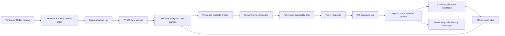

# Production architecture

The submitted implementation is intentionally a single-process reference service. In production, the catalog job and
profile job run separately, immutable artifacts are promoted through dev/staging/prod, and serving replicas load the
same version. Events must include impressions; without them, clicks and plays have selection bias and cannot support a
trustworthy learning-to-rank objective.

Key controls are schema/version validation, catalog-event join-rate alerts, feature and language drift, zero-result
rate, p95 latency, recommendation coverage, repeat rate, and online guardrails. Licensed maturity and regional-rights
feeds must filter candidates before ranking. User deletion propagates to the event store, profiles, and caches.

For larger catalogs, replace exact sparse scoring with an ANN index over multilingual embeddings. Keep the confidence-
adjusted discovery score as a fallback. Add a ranker only after collecting randomized or position-aware exposure data.

